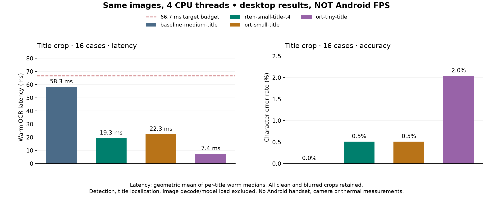
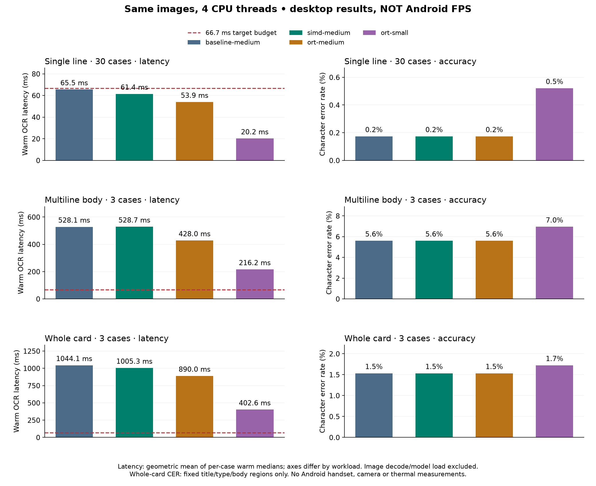

# Android OCR performance investigation

Target: approximately 15 fresh **title OCR** results/second (66.7 ms/frame).
The user clarified that full-card OCR need not run at 15 FPS. A title crop can
bypass text detection; camera acquisition, card localization and rectification
remain separate costs that an app must include in its frame budget.
Measurements here are **desktop CPU measurements, not Android performance claims**.
No Android handset is available in this workspace. Android ARM64 release builds
link with the pinned NDK; compilation is not device validation.

## Title result and app integration

For the app's first title path, **PP-OCRv6 small with RTen** is the useful
starting point: it avoids an additional native runtime dependency and took
19.3 ms across these title crops, versus 58.3 ms for the untouched medium
baseline. This changes the model as well as using the optimized engine; it is
not a same-weight 3× speedup. The small model made one title error, so the
project's accuracy-oriented default remains medium.

| Configuration | Threads | Title median ms | Worst case p95 ms | Exact cases | CER |
| --- | ---: | ---: | ---: | ---: | ---: |
| Original medium / RTen | 4 | 58.3 | 97.2 | 16/16 | 0% |
| Medium / ONNX Runtime | 4 | 48.7 | 80.7 | 16/16 | 0% |
| Small / RTen | 4 | 19.3 | 27.0 | 15/16 | 0.51% |
| Small / ONNX Runtime | 4 | 22.3 | 30.6 | 15/16 | 0.51% |
| Tiny / RTen | 4 | 6.7 | 10.4 | 13/16 | 2.04% |
| Tiny / ONNX Runtime | 4 | 7.4 | 10.7 | 13/16 | 2.04% |

The title cohort contains **eight English titles, each clean and blurred**,
including historic and special frames, with 196 reference characters total.
Each image has 20 measured warm calls after initialization/warmup. Medians are
geometric means of per-image medians; the p95 column is the worst per-image p95.
Runs are sequential rather than randomized, on a shared desktop host, so close
differences do not establish a runtime ranking. Initial five-sample screening
was faster for some configurations; those separate raw runs remain recorded.
This small development cohort does not establish broad title accuracy.



[Every title crop and prediction](title-results/title-grid.png) shows the
failures as well as successes. Small reads the blurred Invocation `DAZE` as
`BAZE`. Tiny also struggles with Goudy `Llanowar Elves`, including its clean
crop; it is an optional experiment, not the recommended accuracy tradeoff.
[Paired summary and all case changes](title-results/summary.json).

Thread count matters even for these small models:

| CPU threads | RTen small ms | ONNX Runtime small ms | ONNX Runtime tiny ms |
| --- | ---: | ---: | ---: |
| 1 | 37.4 | 24.2 | 5.1 |
| 2 | 23.6 | 19.1 | 4.8 |
| 4 | 19.3 | 22.3 | 7.4 |

The same text was returned at all tested thread counts. Four threads did not
always help; sweep 1/2/4 on the actual phone under sustained load. The V5 English
and Latin candidates did not improve the speed/accuracy tradeoff in the initial
five-call, 30-line screening. Their raw results and
[reproducible model downloads](mobile-models.md) are retained.

Load `models/ppocr-v6-small.onnx` with `models/paddle-v6/en.json`, no detector,
and `Options { single_line: true, ..Options::default() }`. Reuse that engine.
The app supplies an upright RGB title crop and retains its crop-to-frame
transform; OCR returns coordinates local to the crop. The app owns card
localization, rectification, title bounds and 180-degree orientation policy.
Confidence is uncalibrated, so these results do not validate an orientation
fallback threshold.

```rust,no_run
use ocracle::{CardOcr, InferenceBackend, ModelConfig, Options};

fn main() -> anyhow::Result<()> {
    let config: ModelConfig = serde_json::from_slice(
        &std::fs::read("models/paddle-v6/en.json")?,
    )?;
    let ocr = CardOcr::load_with_backend(
        "models/ppocr-v6-small.onnx",
        None,
        config,
        InferenceBackend::Rten,
        Some(4),
    )?;
    // Keep `ocr` resident; repeat only this call for each supplied title crop.
    let title = image::open("title.png")?;
    let result = ocr.recognize(
        &title, Options { single_line: true, ..Options::default() },
    )?;
    println!("{}", result.text);
    Ok(())
}
```

`Some(n)` configures inference workers without changing process environment
variables. Explicit RTen settings share one private pool between the engine's
models. `None` preserves the original global policy, including
`RTEN_NUM_THREADS`. RTen may still initialize its global fallback pool and use
global workers for detector preprocessing; this is not a strict limit on all
process threads. The recorded RTen benchmarks use the original global pool with
the stated count; the explicit-pool path has separate numerical/parity tests.

These timings exclude camera capture, card/title localization, perspective
rectification, frame conversion and image decoding. They support a promising
title path; **15 FPS on Android still needs a handset measurement**. See the
[device procedure](android-benchmark.md) and include the app's other stages in
the 66.7 ms budget.

## Engine changes and supplementary whole-card results

The unchanged-weight CTC decoder is **6.07× faster** on the 128-step,
18,710-class synthetic benchmark (`ctc-library-18710.json`). The example imports
`ocracle::ctc` and measures the compiled library. The earlier source-inclusion
measurement remains in `ctc-simd-18710.json` as historical evidence. The decoder preserves the
original validation, Unicode labels, rounded-logarithm ties and confidence.
Safe four-lane reductions generate NEON on ARM64; sums retain their original
order. The engine also reuses contiguous output storage and cached alphabets,
and borrows RGB inputs when no artwork mask requires a copy.

An optional ONNX Runtime CPU backend executes both detection and recognition
with the same pixel and word-box contracts. The default remains RTen and the
registered medium recognizer. The initial investigation used full-card OCR as
the stricter target; that workload remains useful context but is not the
clarified 15 FPS requirement. No handset measurements exist.

| Configuration | Line ms / CER | Multiline ms / CER | Whole card ms / CER |
| --- | ---: | ---: | ---: |
| Original medium / RTen | 65.5 / 0.17% | 528.1 / 5.61% | 1044.1 / 1.53% |
| SIMD medium / RTen | 61.4 / 0.17% | 528.7 / 5.61% | 1005.3 / 1.53% |
| Medium / ONNX Runtime | 53.9 / 0.17% | 428.0 / 5.61% | 890.0 / 1.53% |
| Small / ONNX Runtime | 20.2 / 0.52% | 216.2 / 6.95% | 402.6 / 1.72% |

These are **exploratory desktop results**: geometric means of per-image warm
medians, five measured calls per case, 30 English lines, three multiline bodies,
and three full scans. Whole-card CER scores fixed title/type/body regions only;
all detection and recognition, including unscored predictions, is timed. Whole
cards use the standard artwork mask; cropped bodies never use that mask. The
original detector is used in all four rows. Five samples are insufficient for
reliable tail-latency conclusions. Runs are sequential, not randomized paired
trials; small timing differences may be host variation. All 36 texts were
identical between original, SIMD and ONNX Runtime medium configurations.



[Full raw cases and summaries](results/summary.json),
[whole-card output boxes and transcription](results/card-divination-overlay.png),
[multiline output](results/multiline-divination-overlay.png).

A 256×384 detector reached 49 ms on one tiny rules crop. That is not a whole-card
or phone result. Smaller detector shapes merge lines and increase whole-card
errors: the 512 experiment reached 20–25% CER, and the 640 experiment badly merged
Air Elemental's text. They remain opt-in experiments, not shipped defaults.
[Rejected detector tradeoffs](detector-experiments/latency-accuracy.png).

A separate [Python mobile DB experiment](mobile-models.md#supplementary-db-detector-contract)
reached 103.5 ms / 1.92% CER with tiny detection/recognition models, or
76.8 ms / 2.87% CER at reduced detector resolution. It changes the complete
pipeline and is retained as a future adapter experiment; it is not part of the
shipped Rust path.

## Use and reproduce

The ordinary API and CLI keep their default runtime. To use the alternate CPU
backend, deploy a compatible native ONNX Runtime library and build the feature:

```sh
cargo build --release --locked --features onnxruntime
ORT_DYLIB_PATH=/absolute/path/libonnxruntime.so \
  target/release/ocracle recognize docs/gallery/assets/beleren-title.png \
  --line --backend onnxruntime --threads 4
```

The library exposes `CardOcr::load_profile_with_backend` and
`CardOcr::load_with_backend`; both retain model identity checks/configuration.
Both accept an optional inference-worker count. RTen's default global pool can
also be controlled by `RTEN_NUM_THREADS`; ONNX Runtime sessions disable idle
thread spinning. Output provenance records
the selected backend. Do not change `ORT_DYLIB_PATH` after process initialization.
RTen-format custom checkpoints require the RTen backend; ORT accepts ONNX.

```sh
cargo build --release --locked --all-features --example latency
python3 scripts/performance_suite.py --prepare --download-sources
ORT_DYLIB_PATH=/absolute/path/libonnxruntime.so \
  python3 scripts/performance_suite.py \
  --backend onnxruntime --model models/ppocr-v6-medium.onnx \
  --config models/paddle-v6-medium/en.json --layout standard_card \
  --iterations 20 --label ort-medium --output /tmp/ort-medium.json
```

The suite verifies image/model/config/native-library hashes and stores every
sample and prediction. `--layout` applies only to whole-card cases. To recreate
the original baseline with this configurable harness, build the library at
`4b0fce9` with `examples/latency.rs` from `91110d6`;
that example predates backend controls. The recorded baseline executable was
built before engine changes, and its hash is in every baseline suite artifact.
Use RTen only for this original binary.

[Android build evidence](android-build.md) includes a linked ARM64/API24 release
binary and generated vector instructions. [On-device benchmark commands](android-benchmark.md)
cover deployment, native ORT packaging, thread sweeps and sustained thermals.
[Research and decisions](research.md) covers papers, SIMD, quantization and native
runtime choices. [Runtime-only diagnostics](runtime-diagnostic.md) compare exact
synthetic inputs, independently of image preprocessing and CTC.

The next investigation compares lighter recognizers on clean and blurred title
crops. Load without a detector and use `Options { single_line: true,
..Options::default() }` for an upright crop containing one title. Reuse the
engine across frames. Returned coordinates refer to the supplied crop; the
caller retains the crop-to-frame transform. Preview cadence or cached text is
not counted as fresh OCR.

## Baseline before optimization

Baseline library: `4b0fce9`. See `environment.json` and individual JSON files for
model SHA-256 identities, outputs, cold/load costs and all 20 warm samples.
Run model comparisons sequentially to avoid CPU contention. Images are loaded
before timing; warm measurements include the public OCR call and result creation.
The harness checks text stability on every iteration.

```sh
cargo build --release --locked --example latency
RTEN_NUM_THREADS=4 target/release/examples/latency \
  models/ppocr-v6-medium.onnx models/paddle-v6-medium/en.json \
  docs/gallery/assets/modern-rules.png 20 full
```

Use `models/ppocr-v6-small.onnx` and `models/paddle-v6/en.json` for the smaller
model; use `docs/gallery/assets/beleren-title.png 20 line` to skip detection.
Each invocation loads a fresh engine, measures its first inference, warms three
additional times, then measures 20 calls. Percentiles use the nearest-rank p95;
the median is the upper middle sample. Do not combine cold and warm timings.

| Model / operation | Threads | Median ms | p95 ms |
| --- | ---: | ---: | ---: |
| Medium, detection + recognition | 1 | 533.66 | 557.64 |
| Small, detection + recognition | 1 | 407.76 | 416.53 |
| Medium, detection + recognition | 4 | 192.60 | 201.15 |
| Small, detection + recognition | 4 | 163.84 | 171.49 |
| Medium, isolated title recognition | 1 | 131.24 | 142.89 |

These are two tiny fixtures, not a representative accuracy or camera workload.
Both models read the rules crop as `Draw two cards.`; the medium model reads the
title as `Divination`. The wider evaluation above extends these initial fixtures.

## Research and experiments to pursue

- [RTen performance guidance](https://github.com/robertknight/rten/blob/main/docs/performance.md):
  compare thread counts, operator profiles and input sizes. The pinned runtime
  exposes weight prepacking; the current loader does not enable it. Measure its
  latency benefit and memory/load-time cost before choosing a default.
- [RTen SIMD implementation](https://github.com/robertknight/rten): ARM NEON is
  already supported. Check the pinned implementation and Android compilation;
  custom SIMD should target measured residual costs, not duplicate matrix kernels.
- [RTen quantization](https://github.com/robertknight/rten/blob/main/docs/quantization.md):
  int8 is a promising bandwidth/compute experiment, requiring operator support
  and accuracy validation against these particular exported models.
- [Differentiable Binarization](https://arxiv.org/abs/1911.08947): lightweight
  segmentation and postprocessing motivate investigating detector cost and size.
  Paper throughput does not establish latency on an unspecified Android phone.
- [PP-OCRv5](https://arxiv.org/abs/2603.24373): compact recognition architectures
  motivate comparing smaller models while retaining measured text quality.
  This repository currently distributes PP-OCRv6 candidates, so paper numbers
  are not measurements of these artifacts.

Completed experiments and their raw evidence are retained below and in the
linked reports; the mobile target remains open.

## Weight prepacking experiment

Applied `prepacking-experiment.patch` to enable `ModelOptions::prepack_weights`
for both models, rebuilt release, and reran the four-thread crop workload
sequentially. Medium median was 203.25 ms versus baseline 192.60 ms; small was
163.36 ms versus 163.84 ms. This does **not** demonstrate a useful gain on this
workload. The production loader remains unchanged. Raw results are retained;
repeat with interleaved runs on the target phone before drawing device conclusions.

A diagnostic `RTEN_TIMING=1` run of medium title recognition showed convolutions
at roughly 77–82% of the first two inference calls. This was diagnostic only,
not included in reported benchmark samples. Pinned RTen 0.26 already implements
AArch64 NEON float GEMM and runtime-selected int8 dot-product kernels.
